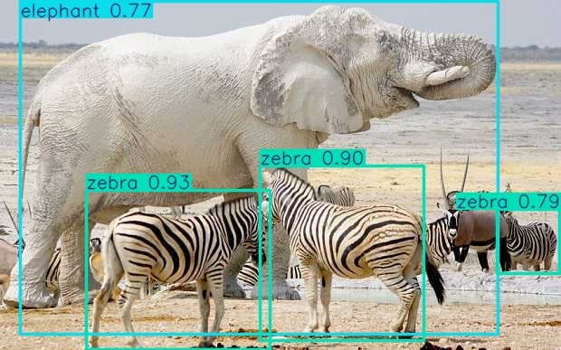
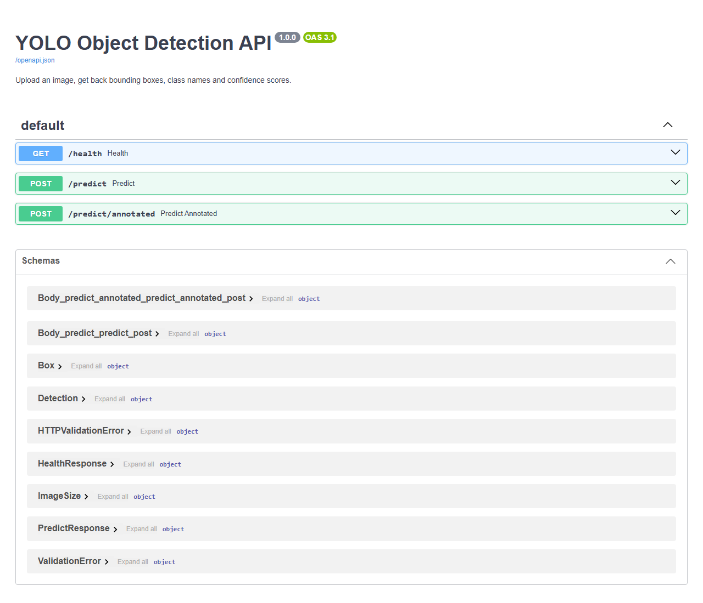
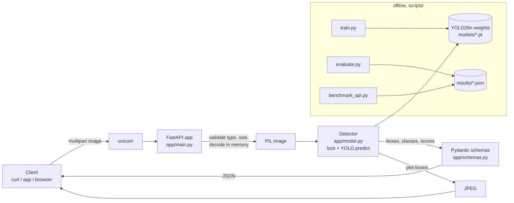

# FastAPI YOLO26 Detector

A small, tested REST API that serves a YOLO26n object detector fine-tuned on a public wildlife dataset: upload an image, get back boxes, class names and confidence scores as JSON.


## Overview

**Problem.** A trained detector in a notebook is hard for anything else to use. Other services need to send an image over HTTP and get structured results back, the API must not fall over on bad input, and someone needs to know how accurate the model really is.

**What this does.**

- Serves an Ultralytics YOLO model behind FastAPI with three endpoints: `GET /health`, `POST /predict` (JSON) and `POST /predict/annotated` (JPEG with boxes drawn).
- Ships a **YOLO26n model fine-tuned on the public [African Wildlife dataset](https://docs.ultralytics.com/datasets/detect/african-wildlife/)** (4 classes: buffalo, elephant, rhino, zebra), trained on this PC with `scripts/train.py`.
- Reports accuracy on the dataset's **held-out test split**, which was not used for training or for picking the best epoch, and measures end-to-end API latency on GPU and CPU. Every number below comes from a file in [`results/`](results/).
- Validates uploads (type, size, decodability) and returns 4xx errors instead of crashing.

> **A note on history.** The first commit of this repo said "YOLO26, fine-tuned on custom dataset", but the checkpoint it shipped (`best.pt`) was really YOLOv8n fine-tuned on `coco128`, Ultralytics' 128-image COCO sample. Its stored mAP was measured on the same images it trained on. That checkpoint is kept, unchanged, as [`models/yolov8n-coco128-demo.pt`](models/) and its metadata is dumped in [`results/legacy_checkpoint.json`](results/legacy_checkpoint.json). The current default model is a real YOLO26n fine-tune with a proper train/val/test split. See [CHANGELOG.md](CHANGELOG.md).

## Demo

`POST /predict/annotated` on a test-split image the model never saw during training ([`tests/assets/elephant_zebra.jpg`](tests/assets/)):



The same image through `POST /predict` (4 detections, abridged; full output in [`docs/demo_response.json`](docs/demo_response.json)):

```json
{
  "model": "yolo26n-african-wildlife.pt",
  "image": {"width": 620, "height": 387},
  "detections": [
    {"class_id": 3, "class_name": "zebra", "confidence": 0.9328, "box": {"x1": 95.8, "y1": 210.4, "x2": 298.9, "y2": 386.3}},
    {"class_id": 3, "class_name": "zebra", "confidence": 0.9008, "box": {"x1": 287.6, "y1": 183.1, "x2": 468.4, "y2": 376.4}},
    ...
  ],
  "inference_ms": 1510.12
}
```

`inference_ms` above is from this single request, made while the GPU was busy with other jobs; the latency table under *Results* gives medians over 100 requests.

Interactive OpenAPI docs at `/docs`:



## Architecture



The model loads once at startup (FastAPI `lifespan`), runs one warm-up inference, and is shared by all requests in that worker.

## Tech stack

| Area | Choice |
|---|---|
| API | FastAPI 0.143, uvicorn 0.54, Pydantic 2.14, python-multipart |
| Model | Ultralytics 8.4.176, YOLO26n (2.5 M params / 5.9 GFLOPs at 640 px; 2.4 M / 5.4 GFLOPs after layer fusion for inference) |
| Deep learning | PyTorch 2.3.1 (CUDA 11.8 on the dev machine, CPU wheel in Docker/CI) |
| Image I/O | Pillow, OpenCV (JPEG encoding of the annotated image) |
| Quality | pytest, httpx (TestClient), ruff, GitHub Actions |
| Packaging | Docker (python:3.12-slim, CPU-only torch, non-root user) |

## Project structure

```
.
├── app/
│   ├── main.py          # FastAPI app: routes, upload validation, lifespan (model load + warm-up)
│   ├── model.py         # Detector: wraps YOLO, thread lock, converts results to schemas
│   ├── schemas.py       # Pydantic response models (drive the OpenAPI docs)
│   └── config.py        # Settings from env vars (MODEL_PATH, DEVICE, MAX_UPLOAD_MB, IMGSZ)
├── models/
│   ├── yolo26n-african-wildlife.pt   # default model (trained here)
│   └── yolov8n-coco128-demo.pt       # original checkpoint, kept for reference
├── scripts/
│   ├── train.py              # fine-tune and copy best weights + curves to models/ and results/
│   ├── evaluate.py           # metrics on a split -> results/metrics_<split>.json
│   ├── benchmark_api.py      # latency against a running server -> results/latency_<label>.json
│   ├── inspect_checkpoint.py # print the training metadata stored inside any .pt file
│   └── reproduce.sh          # run the whole pipeline end to end
├── results/              # every number in this README comes from here
├── docs/                 # demo image, demo JSON, Swagger screenshot
├── tests/                # pytest suite + two test-split images
├── Dockerfile, .dockerignore
├── requirements.txt, requirements-dev.txt, pyproject.toml
└── .github/workflows/ci.yml
```

## Setup

Tested on Windows 10 with Python 3.12.10. PyTorch is installed first and separately, because the right wheel depends on your hardware.

```bash
git clone https://github.com/JaNNi10n/FastAPI-YOLO26-Detector.git
cd FastAPI-YOLO26-Detector
python -m venv .venv
# Windows: .venv\Scripts\activate    Linux/macOS: source .venv/bin/activate

# 1) PyTorch. Pick ONE:
pip install torch==2.3.1 torchvision==0.18.1 --index-url https://download.pytorch.org/whl/cu118  # NVIDIA GPU
pip install torch==2.3.1 torchvision==0.18.1 --index-url https://download.pytorch.org/whl/cpu    # CPU only

# 2) Everything else (pinned)
pip install -r requirements-dev.txt   # or requirements.txt if you don't need tests/lint
```

`numpy` is pinned to 1.26.4 and `opencv-python` to 4.11 on purpose: torch 2.3 was built against NumPy 1.x, and newer OpenCV wheels require NumPy 2.

**Docker** (CPU). Docker was not installed on the dev machine, so this image has **not** been built or tested yet:

```bash
docker build -t yolo-api .
docker run -p 8000:8000 yolo-api
```

## Usage

```bash
uvicorn app.main:app --host 0.0.0.0 --port 8000
```

```bash
curl http://localhost:8000/health
curl -F "file=@tests/assets/elephant_zebra.jpg;type=image/jpeg" "http://localhost:8000/predict?conf=0.4"
curl -F "file=@tests/assets/elephant_zebra.jpg;type=image/jpeg" http://localhost:8000/predict/annotated -o out.jpg
```

Query parameters for both predict endpoints:

| Param | Default | Range | Meaning |
|---|---|---|---|
| `conf` | 0.25 | 0–1 | drop boxes below this confidence |
| `iou` | 0.7 | 0–1 | IoU threshold for non-max suppression (NMS) |
| `max_det` | 100 | 1–300 | maximum boxes returned |

Errors: `415` for a non-image content type, `413` above `MAX_UPLOAD_MB`, `400` for an empty or undecodable file, `422` for invalid parameters or a missing `file` field.

Environment variables:

| Variable | Default | Meaning |
|---|---|---|
| `MODEL_PATH` | `models/yolo26n-african-wildlife.pt` | any Ultralytics detection `.pt` file |
| `DEVICE` | auto (GPU if available) | `cpu`, `0`, ... |
| `MAX_UPLOAD_MB` | 10 | upload size limit |
| `IMGSZ` | 640 | inference resolution |

To serve the original checkpoint (80 COCO classes): `MODEL_PATH=models/yolov8n-coco128-demo.pt uvicorn app.main:app`.

**Train, evaluate and benchmark yourself:**

```bash
python scripts/train.py --model yolo26n.pt --data african-wildlife.yaml --epochs 30   # downloads data + base weights
python scripts/evaluate.py --split test
pytest -q
bash scripts/reproduce.sh          # everything, incl. latency benchmark and demo files
SKIP_TRAIN=1 bash scripts/reproduce.sh
```

## Results

All numbers were produced on this machine: **Windows 10, NVIDIA GeForce RTX 3050 Ti Laptop GPU (4 GB), Python 3.12.10, torch 2.3.1+cu118, Ultralytics 8.4.176**.

### Detection accuracy (African Wildlife dataset)

| Split | Images | Used for | Precision | Recall | mAP50 | mAP50-95 |
|---|---|---|---|---|---|---|
| val | 225 | choosing the best epoch | 0.952 | 0.909 | 0.966 | 0.818 |
| **test** | 227 | nothing (held out) | **0.981** | **0.920** | **0.975** | **0.847** |

The **test** row is the honest number: those 227 images were never used for training or for choosing the checkpoint. The val split chose the best epoch, so its numbers are slightly optimistic. Measured with `scripts/evaluate.py` (Ultralytics `model.val()`, 640 px, conf 0.001, standard NMS) on the GPU above. Source: [`results/metrics_test.json`](results/metrics_test.json), [`results/metrics_val.json`](results/metrics_val.json), with logs in `results/eval_*_log.txt`.

Per class, test split:

| Class | Instances | Precision | Recall | mAP50 | mAP50-95 |
|---|---|---|---|---|---|
| buffalo | 66 | 0.983 | 0.894 | 0.953 | 0.868 |
| elephant | 99 | 0.979 | 0.919 | 0.972 | 0.802 |
| rhino | 75 | 0.987 | 0.973 | 0.992 | 0.915 |
| zebra | 135 | 0.976 | 0.895 | 0.984 | 0.804 |

**How it was trained.** `yolo26n.pt` (COCO-pretrained) was fine-tuned for 30 epochs at 640 px on the 1,052 training images with Ultralytics defaults (optimizer `auto`, which picked AdamW at lr 0.00125; mosaic augmentation, turned off for the last 10 epochs), seed 0, `deterministic=True`. The checkpoint kept is the epoch with the best val mAP50-95 (epoch 27). Epoch time summed across the runs is about 27.5 minutes on the laptop GPU. The run had to be resumed three times; see *Limitations* and the full log in [`results/train/train_log.txt`](results/train/train_log.txt). Curves: [`results/train/results.png`](results/train/results.png), raw per-epoch values: [`results/train/results.csv`](results/train/results.csv).

### API latency

`scripts/benchmark_api.py`: one uvicorn worker, 100 sequential `POST /predict` requests after 5 warm-up requests, with the 620×387 test image, client and server on the same machine. *Client latency* is the full HTTP round trip (upload, decode, inference, JSON). *Server inference* is the time spent inside the model call, as reported in the response's `inference_ms`.

| Device | Client p50 (ms) | Client p95 (ms) | Server inference p50 (ms) | Throughput (req/s, sequential) |
|---|---|---|---|---|
| GPU, RTX 3050 Ti (`cuda:0`) | 64 | 397 | 50 | 5.4 |
| CPU (`cpu`) | 961 | 1643 | 948 | 1.0 |

Source: [`results/latency_gpu.json`](results/latency_gpu.json), [`results/latency_cpu.json`](results/latency_cpu.json). During these runs the laptop was also running other jobs: `nvidia-smi` showed about 3.6 of the GPU's 4 GB in use and 100 % utilisation from other processes. The gap between p50 and p95 comes from that contention. Treat these as rough figures for a busy laptop, not a controlled benchmark. Latency on an idle machine was not measured.

### Tests

`pytest -q` result: **16 passed** (log: [`results/pytest.txt`](results/pytest.txt)). The suite covers health, real predictions on a test-split image (it must find the elephant and the zebras), confidence filtering, PNG with alpha, the annotated endpoint, 415/413/400/422 error paths, and 12 concurrent requests mixing two different images, to check that results never get swapped.

## How it works

The decisions below are the ones worth being able to explain.

1. **Why YOLO26n.** YOLO26 is the current Ultralytics detector family, and "n" (nano) is its smallest size: 2.5 M parameters and 5.9 GFLOPs. That trains in under half an hour on a 4 GB laptop GPU and still runs on CPU. YOLO26 also has an NMS-free *end-to-end* head, but in Ultralytics 8.4.176 the default (`nms=None`) runs the regular head followed by standard non-max suppression (NMS), and that default is what this API and the evaluation use. So `iou` does apply. I checked this: `model.predictor.model.end2end` is `False` after a default `predict()`.

2. **Why fine-tune instead of training from scratch.** The base `yolo26n.pt` was pretrained on COCO, which already contains *elephant* and *zebra*. Ultralytics noticed this when loading and remapped those two class rows of the head from the pretrained weights ("Remapped 2/4 cls head rows ... by class name" in the training log). That is why validation mAP50 was already about 0.82 after the first epoch. Buffalo and rhino had to be learned from scratch.

3. **Why this dataset and split.** African Wildlife is public, small (about 1.5k images), has a fixed train/val/test split (1,052 train / 225 val / 227 test images), and is a real fine-tuning task, unlike `coco128`, which validates on its own training images. Training used only `train`, `val` picked the best epoch, and `test` was used only by `scripts/evaluate.py` for the final numbers. It was run twice, because the first run hit the evaluation bug in point 12; the model did not change between the two runs.

4. **Load once, warm up, share.** Loading weights is slow compared with one inference, and the first CUDA call is slower still (CUDA context and cuDNN set-up). The FastAPI `lifespan` hook loads the model once per worker, runs one dummy inference, and stores it on `app.state`. Tests use the same path through `TestClient`'s context manager.

5. **`def`, not `async def`.** Inference is CPU/GPU-bound, blocking work. An `async def` endpoint would run it *on the event loop*, so one slow request would freeze `/health` and every other request. A plain `def` endpoint is run by FastAPI in its thread pool, so the event loop stays free.

6. **Why there is a lock.** Thread-pool execution means two requests can call the same `YOLO` object at once. `YOLO.predict()` writes each call's options (`conf`, `max_det`, ...) onto one shared predictor object before running, so two concurrent calls could swap thresholds. A `threading.Lock` around inference makes calls serial within a worker. That is fine for a GPU, which runs one batch at a time anyway. To scale, run more uvicorn workers (each loads its own model) or add request batching.

7. **No temp files.** The original version wrote every upload to a shared `temp.jpg`, so two concurrent requests could read each other's image, and the file was never cleaned up. Uploads are now read into memory (at most `MAX_UPLOAD_MB` + 1 bytes, so an oversized upload is never fully buffered), decoded with Pillow, rotated according to EXIF, and converted to RGB. Pillow's decompression-bomb limit is set explicitly.

8. **Fail with 4xx, not 500.** Wrong content type gives 415, too large gives 413, garbage bytes give 400 (Pillow cannot identify the file), and out-of-range `conf`/`iou`/`max_det` give 422 (declared with `Query(ge=..., le=...)`, so FastAPI validates them and documents them in OpenAPI). The original code returned 500 with an `IndexError` for non-images.

9. **Typed responses.** Pydantic models (`PredictResponse`, `Detection`, `Box`) make the JSON shape explicit, validate that confidence is in [0, 1], and generate the schema shown at `/docs`. Boxes are in **original-image pixel coordinates** (`x1,y1` top-left, `x2,y2` bottom-right), and the image size is returned so clients can normalise them.

10. **Config through env vars.** `MODEL_PATH`, `DEVICE`, `MAX_UPLOAD_MB` and `IMGSZ` mean the same code runs on a GPU laptop, in a CPU container, or with a different model, without code changes. The default model path is resolved relative to the package, not the working directory.

11. **Reproducibility.** Dependencies are pinned. `train.py` copies the run config and curves into `results/train/`, `evaluate.py` writes metrics together with hardware and library versions, and `inspect_checkpoint.py` reads the metadata any Ultralytics `.pt` file carries. That last script is how the legacy checkpoint's real origin was found.

12. **An evaluation bug worth knowing about.** The first `evaluate.py` run reported val mAP50 = 0.772, far below the 0.965 the training log showed for the same checkpoint on the same split. The log also had several `WARNING NMS time limit ... exceeded` lines. Ultralytics' NMS gives up after `2 s + 0.05 s × batch` and silently returns **no boxes** for the rest of that batch. The GPU was shared with other jobs, so NMS was slow and whole batches were scored as misses. `evaluate.py` now disables that time limit, because evaluation must score every image. The re-run matched training (val mAP50 0.966, mAP50-95 0.818, versus 0.965 / 0.818 at epoch 27 in `results.csv`), and the test numbers went from 0.941 to 0.975 mAP50. Logs of both runs: [`results/eval_first_run_nms_timeout_log.txt`](results/eval_first_run_nms_timeout_log.txt) (7 time-limit warnings), [`results/eval_val_log.txt`](results/eval_val_log.txt), [`results/eval_test_log.txt`](results/eval_test_log.txt). The lesson: when a metric disagrees with another measurement of the same thing, read the warnings before trusting either. (The API path is not affected. It runs one image per call, and a dropped result would show up as an empty `detections` list, not a wrong score.)

13. **Reporting the real device.** `/health` used to report `cpu` even when inference ran on the GPU, because `YOLO.device` describes the copy of the weights loaded from disk, not the copy the predictor moved to CUDA. It now reads `model.predictor.device`, and a test checks it.

## Limitations and next steps

- **Narrow domain.** The model only knows four animal classes, from mostly daytime, fairly close-up photos. It is not a general detector. Use `MODEL_PATH` with another checkpoint for other tasks.
- **Small test set.** 227 test images (375 boxes) means the per-class numbers carry a few points of uncertainty. No confidence intervals were computed.
- **Training run.** 30 epochs, single seed, default hyperparameters. The GPU was shared with other processes, and the run was interrupted three times: a CUDA out-of-memory error in epoch 11 (batch 16), then a Windows page-file error on resume with 4 dataloader workers, then a dataloader timeout in epoch 28 with 2 workers. Each time it was resumed from the last saved epoch (`last.pt`) with batch size 8, and the last resume used 0 workers. Epochs 1–10 therefore used batch 16 and epochs 11–30 used batch 8, so this is not exactly the run a single uninterrupted `train.py` call would produce. Full log: `results/train/train_log.txt`. A longer or tuned run, or the larger `yolo26s`, would probably score higher. This was not tried.
- **One inference at a time per worker** (the lock). There is no dynamic batching, so throughput scales only by adding workers or GPUs.
- **Docker and CI are untested.** Docker was not available on the dev machine, and the GitHub Actions workflow has not run yet because the repo had not been pushed when these changes were made.
- **No auth, rate limiting or request logging**, so don't expose this publicly as-is.
- Next steps: ONNX/TensorRT export for faster CPU/GPU inference, request batching, Prometheus metrics, and a small web UI.

## License and credits

- **Code** in this repository: [MIT](LICENSE) © 2026 Shivansh Bhardwaj.
- **[Ultralytics](https://github.com/ultralytics/ultralytics)** (YOLO26, training/inference library) is licensed under **AGPL-3.0**. The bundled `.pt` weights are derived from Ultralytics' pretrained weights, so they and any service that distributes them are subject to AGPL-3.0, unless you have an Ultralytics Enterprise license. The MIT license covers only the original code here.
- **[African Wildlife dataset](https://docs.ultralytics.com/datasets/detect/african-wildlife/)** by Ultralytics, distributed under AGPL-3.0. The two images in `tests/assets/` come from its test split.
- **coco128** (used by the legacy checkpoint) is a subset of [COCO](https://cocodataset.org/) (annotations CC BY 4.0).
